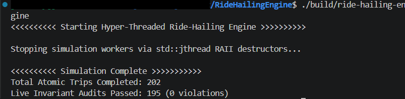

## Ride Hailing Engine

A simple implementation of a concurrent, multi-threaded ride hailing engine written in Modern C++.
This is merely the initial commit, but more detailed, and meticulous documentation will be
provided along the way.

### Requirements
- [x] CMake
- [x] C++ Compiler (e.g. GCC, Clang)
> I warmly recommend either of the aforementioned two to be able to
> access and use TSan (ThreadSanitizer) to help detect race conditions

### Running the Project
After making sure your system has met the aforementioned requirements:
1. Clone the project
2. cd into the base directory.
3. Run the following commands in order:

    - cmake -B build
    - cmake --build build

4. After they complete, an executable with the name `ride-hailing-engine`
will be availabe inside the newly generated `build` directory. Run it.
That's it.

## Verification & Output

### Standard Multi-Threaded Run

